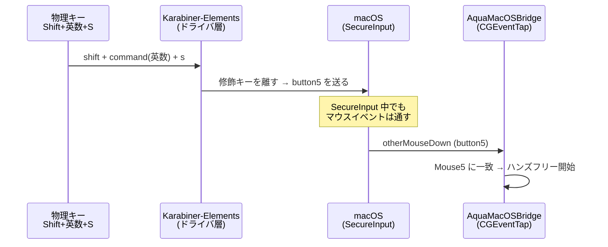

# 1. Aqua Voice のハンズフリー起動をマウス第5ボタン経由にする

Date: 2026-10-13

## Status

Accepted

## Context

Aqua Voice のハンズフリー起動ショートカット（物理キー **Shift+英数+S**）が、しばしば反応しなくなる。
画面をロックして解除すると直るが、発生のたびにこれを行うのはトイルになっていた。

### 原因

| 層 | 内容 |
|---|---|
| 直接の原因 | macOS の SecureInput が有効なあいだ、Aqua Voice はキーボードのイベントを受け取れない |
| その状態が生じた条件 | 終了したプロセス（観測時は Slack）が有効にした SecureInput が、macOS に取り残される。保持者の PID は死んでいるのに `IsSecureEventInputEnabled()` は 1 のまま。Slack を再起動しても消えず、ロック→解除（セッションのリセット）でのみ消える |
| 防げない理由 | Aqua Voice（0.21.0）のヘルパー `AquaMacOSBridge` は、ショートカットを `CGEventTap` だけで検知する。SecureInput の影響を受けない Carbon の `RegisterEventHotKey` を使っていない。SecureInput の状態はログに記録するだけで、回避処理はない |

### 決定の前提にした事実

- `AquaMacOSBridge` のイベントタップは `CGEventTapCreate(kCGSessionEventTap, head, default, 0x6001c00)` で作られる。マスクには keyDown・keyUp・flagsChanged に加えて、**otherMouseDown/Up（第3以降のマウスボタン）**が入っている
- Aqua Voice のショートカット設定は `Mouse3`・`Mouse4`・`Mouse5` を正式なキー名として受け付ける
- SecureInput が遮断するのはキーボードのイベントで、マウスのイベントは遮断しない
- Karabiner-Elements はキーボードのドライバの層で動くため、SecureInput の影響を受けない

調査の経緯と証拠は、2026-10-13 の Obsidian デイリーノート（AI working 配下）に残している。逆アセンブルは rea（Hopper）による。

## Decision

ハンズフリーの起動を、キーボードのイベントではなく**マウス第5ボタンのクリック**で Aqua Voice に届ける。

1. Karabiner に「`shift + command + s` → `pointing_button: button5`」を追加する（`karabiner.json` の rules の先頭。英数キーは押下中 `left_command` になるので、物理キーの Shift+英数+S がこれに当たる）
2. Aqua Voice の「ハンズフリーを有効化」を `Mouse5` **単独**で登録する

Karabiner は、`from` の必須修飾キーを離してから `to` を送る。そのため Aqua Voice が受け取るのは修飾キーのない `Mouse5` だけになり、照合が修飾キーの扱いに左右されない。



## Consequences

### 良くなること

- SecureInput が取り残されても、ハンズフリーのショートカットが届く。ロック→解除が不要になる（2026-10-13、取り残し中に動作を確認）

### 悪くなること・リスク

- ⇧⌘S が全アプリでマウス第5ボタンのクリックになる。「別名で保存」（⇧⌘S）などは使えない
- 物理マウスに第5ボタン（「進む」）があれば、それでもハンズフリーが始まる
- **未確認**: Aqua Voice がクリックを握りつぶさずに通すと、ブラウザ上で押したとき「進む」が動く可能性がある
- 「有効化」（F12）は従来どおりキーボード経由のため、SecureInput の取り残し中は効かない

### 見直す条件

- Aqua Voice が `RegisterEventHotKey` 相当の仕組みや SecureInput の回避処理を入れたら、このルールを外してキーボードのショートカットに戻す
- Aqua Voice が `Mouse5` をショートカットに使えなくなったら、別の方法を探す

## 再設定の手順（runbook）

Mac を新しくしたときや、Aqua Voice の設定を初期化したときに使う。

### 対象と保持者

| 対象 | 保持者 | 注意 |
|---|---|---|
| `shift + command + s → button5` のルール | このリポジトリの `karabiner.json` | Karabiner はファイルの変更を自動で読み込む |
| 「ハンズフリーを有効化」= `Mouse5` | **Aqua Voice のアカウント（サーバー同期）** | `~/Library/Application Support/Aqua Voice/settings.json` を直接書き換えても、起動時にサーバーの値で上書きされる。必ず設定画面から登録する |

### 手順と状態の変化

| # | 操作 | 状態・確かめること |
|---|---|---|
| 1 | `karabiner.json` に上記ルールがあることを確認する | `~/.local/share/karabiner/log/console_user_server.log` に `core_configuration is updated` が出ている |
| 2 | `karabiner.json` に一時的な対応「`f11`（修飾キーなし）→ `button5`」を足す | 記録画面で Shift から押すと修飾キーまで記録されてしまうため、修飾キーなしで第5ボタンを送る手段が要る |
| 3 | Aqua Voice の「ハンズフリーを有効化」の鉛筆アイコン → **F11 だけ**を押す → 保存 | 表示が `Mouse 5` だけになっていること。Shift+英数+S で記録すると `Left Shift+Left ⌘+Mouse 5` になり、「同じキーを2回使用することはできません」で保存できない |
| 4 | 手順 2 の一時的な対応を消す | 中断してよいのはここまで終えてから。消し忘れると F11 が第5ボタンのままになる |
| 5 | テキスト欄で Shift+英数+S を押す | 合格条件: ハンズフリーの録音が始まる |

### 効かないときの切り分け

```bash
# SecureInput が有効か（1 なら有効）
python3 -c "import ctypes; c=ctypes.cdll.LoadLibrary('/System/Library/Frameworks/Carbon.framework/Carbon'); print(c.IsSecureEventInputEnabled())"

# 保持者の PID（取り残しなら、その PID のプロセスは存在しない）
ioreg -l -w 0 | grep -o '"kCGSSessionSecureInputPID"=[0-9]*' | sort -u

# Aqua Voice 側の記録（keyboard.secure_input_active などが出る）
tail -50 ~/Library/Logs/"Aqua Voice"/bridge.log
```
